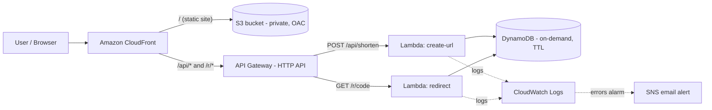

# Serverless URL Shortener on AWS


A production-style, fully serverless URL shortener built **entirely on AWS** and defined as infrastructure-as-code with AWS SAM (CloudFormation). One command deploys the whole stack.

## Architecture



## AWS services used

| Service | Purpose |
|---|---|
| **CloudFront** | Single HTTPS entry point; serves the site and routes API paths to API Gateway |
| **S3** | Private bucket for the frontend, accessible only through CloudFront (Origin Access Control) |
| **API Gateway (HTTP API)** | REST endpoints with built-in throttling |
| **Lambda (Python 3.12, arm64)** | `create-url` and `redirect` functions |
| **DynamoDB** | On-demand table, TTL-based expiry, point-in-time recovery, encryption at rest |
| **IAM** | Least-privilege policy per function (only the DynamoDB actions each one needs) |
| **CloudWatch** | Log groups with 14-day retention and error alarms |
| **SNS** | Email notifications when an alarm fires |
| **CloudFormation / SAM** | The entire stack as code |

## How it works

1. `POST /api/shorten` with `{"url": "https://..."}` validates the URL (http/https only, max 2048 chars), generates a random 7-character code, and stores it with a conditional write (`attribute_not_exists`) so codes can never collide or overwrite each other.
2. `GET /r/{code}` looks the code up, checks expiry itself (DynamoDB TTL deletes lazily), increments a hit counter, and returns a `302` redirect.
3. Expired links are removed automatically by DynamoDB TTL (default 365 days).

## Design decisions

- **Same-origin API via CloudFront**: the site and API share one domain, so no CORS configuration is needed.
- **Private S3 bucket + OAC**: the bucket is never public.
- **Least-privilege IAM**: `create-url` can only `PutItem`; `redirect` can only `GetItem`/`UpdateItem`.
- **Analytics never break redirects**: the hit counter update is wrapped so a failure still redirects the user.
- **Cost-aware**: pay-per-request DynamoDB, 128 MB arm64 Lambdas, `PriceClass_100` CDN. Light usage stays within or near the free tier.

## Deploy

**Prerequisites:** an AWS account, [AWS CLI](https://docs.aws.amazon.com/cli/latest/userguide/getting-started-install.html) configured (`aws configure`), and the [SAM CLI](https://docs.aws.amazon.com/serverless-application-model/latest/developerguide/install-sam-cli.html).

```bash
git clone https://github.com/<your-username>/aws-serverless-url-shortener.git
cd aws-serverless-url-shortener

./deploy.sh                              # default stack name: url-shortener
./deploy.sh my-stack me@example.com      # optional: custom name + alarm emails
```

The script builds the functions, deploys the stack, uploads the frontend to S3, invalidates the CDN cache, and prints your site URL. (Confirm the SNS email subscription if you passed an address.)

## API

```bash
# Create
curl -X POST https://<cloudfront-domain>/api/shorten \
  -H "Content-Type: application/json" \
  -d '{"url": "https://aws.amazon.com/lambda/"}'
# -> {"code": "aB3xY9z", "long_url": "...", "expires_at": 1798000000}

# Follow
curl -i https://<cloudfront-domain>/r/aB3xY9z
# -> HTTP/2 302, location: https://aws.amazon.com/lambda/
```

## Run the tests

```bash
python -m venv .venv && source .venv/bin/activate
pip install -r requirements-dev.txt
cfn-lint template.yaml
pytest -q
```

Tests use [moto](https://github.com/getmoto/moto) to mock DynamoDB, so no AWS account is needed. GitHub Actions runs the linter and tests on every push.

## Clean up

```bash
./teardown.sh        # empties the bucket and deletes the whole stack
```

## Ideas for next steps

- Custom domain with Route 53 + ACM certificate
- AWS WAF rate-based rule on the CloudFront distribution
- CI/CD deploy job using GitHub Actions with OIDC (no long-lived keys)
- CloudWatch dashboard and X-Ray tracing
- Custom aliases and a stats endpoint (`GET /api/stats/{code}`)
